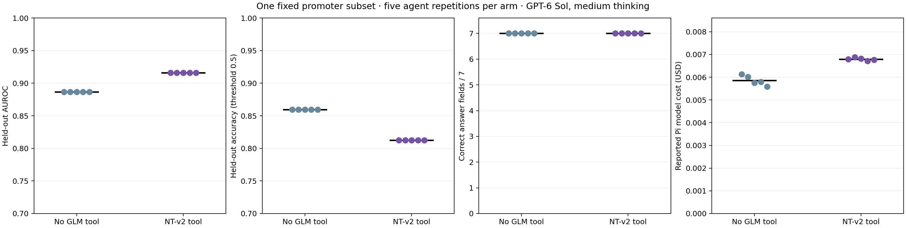

# Genomic-LM tool availability: Pi agent pilot

A reproducible first iteration of a **genomic language model as a tool for a Pi agent**. On a small public promoter-classification subset, five `openai/gpt-6-sol` (medium) runs had only a GC/3-mer baseline tool; five matched runs also had a tool backed by frozen **Nucleotide Transformer v2 50M** embeddings. Each run has **one user prompt**, an independent persistent Pi session, and a streamed JSON event trace.

**Result on this single fixed subset:** the GLM-tool arm selected the embedding features in all five runs. Test AUROC was **0.916016 versus 0.886719** for the composition baseline (+0.029297); accuracy at a 0.5 threshold was **0.812500 versus 0.859375** (−0.046875). Both arms answered all seven machine-graded fields correctly in all five repetitions. This is a mixed result, **not evidence of general uplift across biology**. Five agent repetitions are not five independent biological evaluations. See [methodology and limitations](docs/methodology.md).



## Repository map

```text
scripts/
  prepare_data.py        # pinned public dataset download and balanced subset
  prepare_model.py       # pinned 50M model, code, tokenizer and checksum verification
  embed_sequences.py     # local frozen-model inference (Apple MPS or CPU)
  evaluate_features.py   # fixed validation selection and held-out classification
  run_trials.py          # headless Pi orchestration, 5 pairs of sessions/traces
  score_and_plot.py      # independent answer grading and comparison plot
extensions/benchmark.ts  # allowlisted Pi tools; extra GLM tool only in treatment
config: task_prompt.txt, requirements.txt, data/provenance.json,
        model_provenance.json, embedding_provenance.json
results: comparison.png, results.csv, results.json, runs/<arm>-trial-NN/
private/regenerated: data/{source/,train.csv,test.csv}, .cache/{model/,embeddings.npz,evaluation.json}
```

## Reproduce

Requires **Pi 1.3.0**, authentication for `openai/gpt-6-sol`, Python 3.11, `uv` (or an equivalent venv/pip installer), and network access for the public dataset/model downloads and Pi requests. Tested on Apple Silicon, 16 GB RAM. The model weights are ~213 MiB; the entire cached model/data/features fit comfortably under 1 GiB, although installing Python/PyTorch can use substantially more disk. **No external GPU was rented.** Locally precomputing 192 embeddings took ~7.4 seconds on MPS in the tested environment; this excludes installation, download, and model-load time.

```bash
cd ~/AI_projects/genomic-lm-agent-benchmark
uv venv --python 3.11 .venv
uv pip install --python .venv/bin/python -r requirements.txt
.venv/bin/python scripts/prepare_data.py
.venv/bin/python scripts/prepare_model.py
.venv/bin/python scripts/embed_sequences.py
.venv/bin/python scripts/evaluate_features.py
.venv/bin/python scripts/run_trials.py --trials 5  # 10 paid Pi prompts
.venv/bin/python scripts/score_and_plot.py
```

`run_trials.py` **skips existing run directories** and refuses to overwrite a run it starts. To create a genuinely new experiment, copy the source/configuration into a new workspace rather than mutating these records. You can smoke-test with `--trials 1` and later run `--trials 5` to fill in the remaining pairs. Run all scripts from this repo; each script resolves paths relative to its own file.

The tested local environment used the versions in `requirements.txt` from an existing Python installation exposed via a virtual environment with `--system-site-packages`, with `safetensors` installed in that venv. A fresh isolated installation with the pinned versions is the intended reproduction recipe but has not been independently verified on other machines. CPU inference is a fallback if MPS is absent and will take longer. Hugging Face's model requires `trust_remote_code=True`: `prepare_model.py` pins and hashes those downloaded Python files; review that code before running in a sensitive environment. Model/data source revisions and file checksums are saved in the provenance JSON files.

The upstream dataset card does not state a redistribution license. Source and sampled sequences are therefore downloaded locally and Git-ignored; obtain them from the linked source rather than republishing them. **Session/event traces can contain prompt content and tool outputs**; review them before sharing or committing. Current traces use public data and only narrow tool results.

## What this does and does not control

The control arm has **no `bash`, `read`, arbitrary network tool, or model inference tool**. Only three narrow, auditable tools exist in treatment, versus two in control. The genomic feature tool exposes a **precomputed, fixed evaluation of model embeddings**, not arbitrary sequence querying; this keeps cost and outputs identical across trials. It is a controlled *tool-availability* pilot, not a sandbox for adversarial agents, not an end-to-end tool-building benchmark, and not a study of every biological research task. Details: [docs/methodology.md](docs/methodology.md).

Pi model-usage estimates across all ten runs summed to **$0.06325**; this is not a billing receipt and excludes local electricity/compute. Treatment added roughly $0.00094 in reported Pi model cost per prompt relative to control in this pilot. Scaling to externally hosted inference should account separately for provisioned GPU seconds, CPU/memory, storage, transfer, retries and idle time; no cloud pricing is required for this local iteration.
