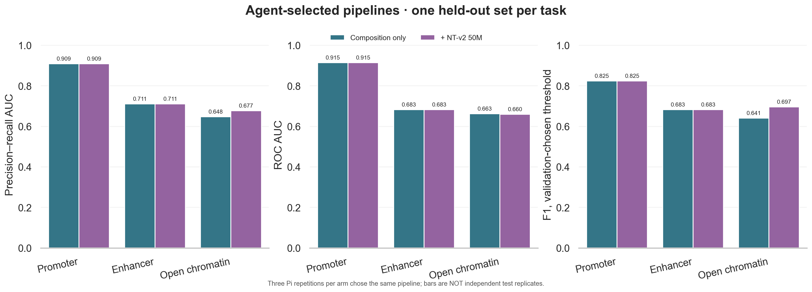

# v2 · Three-task genomic-model tool-availability benchmark

This is the newer, three-task extension of the [original promoter-only pilot](../README.md).

## The question, without the machinery

Does giving a Pi research assistant access to a **genomic language model** help it choose a better way to analyze DNA sequences? We tested three separate yes/no questions: *does this sequence resemble a promoter*, *an enhancer*, or *an annotated open-chromatin region*? These are biologically useful candidate-prioritization tasks, but a sequence prediction alone cannot prove that a region is active in a particular tissue. Each dataset has its own negative examples; the three labels are **not** competing classes in one classifier.

For each question, one Pi agent could choose between simple DNA-composition features (GC content and short sequence patterns). An otherwise identical agent also had access to features from **Nucleotide Transformer v2 50M**. Agents compared options on training-validation data, selected one, then received **one held-out test result**. The genomic-model tool was optional: having access did not force the agent to use it.

**Bottom line:** the agents kept the conventional features for promoters and enhancers. Their test scores are **exactly equal between arms because they submitted exactly the same classifier**, not because genomic-model features happened to score identically. For open chromatin they selected the genomic features, with better precision–recall AUC and F1 on this small test subset, though slightly worse ROC AUC. This is a task-specific development result, **not a claim of broad GLM uplift**.

## Results at a glance (one fixed test subset per task)

| Task | Control choice | +GLM-tool choice | Control test AUPRC | +GLM-tool test AUPRC | Control F1 | +GLM-tool F1 |
|---|---|---|---:|---:|---:|---:|
| Promoter | GC + 5-mers | GC + 5-mers | 0.909 | 0.909 | 0.825 | 0.825 |
| Enhancer | GC + 3-mers | GC + 3-mers | 0.711 | 0.711 | 0.683 | 0.683 |
| Open chromatin | GC + 3-mers | NT-v2 50M | 0.648 | **0.677** | 0.641 | **0.697** |

AUPRC summarizes how well a model ranks positive examples when precision and recall matter; F1 evaluates yes/no predictions at the chosen threshold. The open-chromatin model's **ROC AUC decreased slightly** (0.663 to 0.660), so even there the result is mixed. Three agent repetitions per arm made the same decision on the **same fixed data**: they are **not independent biological replicates**.



## Technical setup and run outcomes

This study uses separate public datasets for human non-TATA promoters, enhancers, and open chromatin, with 256 balanced training and 128 balanced test sequences per task. Each task had three one-prompt Pi runs with composition-only tools and three with the NT-v2 embedding tool also available: **18 persistent sessions** in `runs/`. The Pi model was `openai/gpt-6-sol` at medium thinking in both arms.

Each agent called `describe_task` and validated every available feature family on a training-only split. It chose a feature family, logistic-regression regularization `C`, and decision threshold using validation AUPRC/F1, then made **one held-out test submission**. The agent had no general shell, filesystem reader, or arbitrary Python runner; the control could not call the genomic feature family. All 18 followed the protocol, chose the validation-optimal configuration, and reported **9/9** machine-checked fields. The test outcomes shown above are **selected pipelines**, not scores for every feature family: NT-v2 was *not* submitted to the held-out promoter or enhancer test sets.

## Structure

```text
scripts/prepare_data.py         pinned public data and balanced subset with similarity screen
scripts/audit_similarity.py     7-mer nearest-train similarity audit
scripts/embed_sequences.py      reuse parent pinned model, cache frozen embeddings locally
scripts/analysis.py             shared composition/embedding features and classifier/metrics
scripts/prepare_validation.py   computes ONLY training-validation metrics
scripts/submit.py               fit on full train, compute test metrics after one agent submission
scripts/run_trials.py           3 tasks × 2 arms × 3 headless Pi runs
scripts/score_and_plot.py       audits choices, grades answers, draws Seaborn plot
scripts/verify.py               checks file hashes, split screen and all saved runs
extensions/benchmark.ts         restricted Pi tool surface and one-shot submission guard
data/provenance.json            source revisions and SHA-256 checksums
similarity_audit.json           sequence-similarity screen findings
embedding_provenance.json       local inference and weight provenance
runs/                           session JSONL, event JSONL, stderr, manifest for each run
exploratory_unfiltered/          archived development run with a flagged similarity issue
```

Private downloaded CSVs, model weights, embeddings and validation cache are **not checked into Git**. Public dataset cards do not state redistribution terms. Sources: [Genomic Benchmarks](https://huggingface.co/katarinagresova) and [Nucleotide Transformer v2 50M](https://huggingface.co/InstaDeepAI/nucleotide-transformer-v2-50m-multi-species). The model revision/files are pinned and hashed in the parent repo's `model_provenance.json`.

## Reproduce

Follow the [parent environment instructions](../README.md) to create `.venv` using Python 3.11 and `requirements.txt`; prepare the parent model with `scripts/prepare_model.py`. From the parent repo root:

```bash
.venv/bin/python v2/scripts/prepare_data.py
.venv/bin/python v2/scripts/audit_similarity.py
.venv/bin/python v2/scripts/embed_sequences.py
.venv/bin/python v2/scripts/prepare_validation.py
.venv/bin/python v2/scripts/run_trials.py --trials 3   # 18 paid Pi requests; skips existing runs
.venv/bin/python v2/scripts/score_and_plot.py
.venv/bin/python v2/scripts/verify.py
```

Run `--trials 1` for a smoke test, then `--trials 3` for remaining runs. To repeat from scratch, **copy the source into a new workspace**; don't overwrite session provenance. Tested on Apple Silicon with 16 GB RAM. Frozen embedding inference on 1,152 sequences took ~51 seconds on Apple MPS, excluding downloads and model load. No external GPU was rented. Pi reported **$0.1393** in model usage for the final 18 calls (not a billing statement); development and archived exploratory runs added additional cost.

## Important limitations

- The source provides train/test splits but not coordinates suitable for **chromosome-aware** validation. We screened exact/reverse-complement duplicates and excluded test sequences with sampled-train 7-mer Jaccard similarity ≥ 0.8. This heuristic does **not** prove independence or eliminate homologous regions. See `similarity_audit.json`.
- The screen was added **after** an exploratory run exposed two near-matching promoter sequences. The preliminary runs are preserved under `exploratory_unfiltered/`. The revised experiment remains a **development study**, not an untouched confirmatory holdout.
- Source subsets are balanced and small (256 train, 128 test per task); results may not transfer to real prevalence, loci, tissues, or technologies. No confidence intervals or formal hypothesis tests are asserted for these differences.
- Both arms use a **fixed safe analysis API** and frozen features, not unrestricted agent-written code. This is a tool-availability/analysis-selection benchmark, not an end-to-end autonomous research benchmark. The tool boundary is not a malicious-process security sandbox; use a VM/container before granting arbitrary code execution.
- `prepare_validation.py` never reads held-out test CSVs. `submit.py` computes test metrics once per agent process after the extension accepts its only submission. Agents cannot inspect the private CSVs/cached embeddings through their allowed tools. Repeated submissions in separate runs use the same fixed test set and must not be interpreted as independent test experiments.
- The grader checks numerical/choice fidelity and tool-use protocol. Scientific prose and caveats are saved for manual review, not semantically graded. Trace files can contain prompts and tool results: review before sharing.

For detailed trial-level results and correctness flags, inspect `results.json` or `results.csv`; for tool arguments, responses and internal Pi lineage, inspect `runs/<task>-<arm>-NN/events.jsonl` and `sessions/*.jsonl`.
